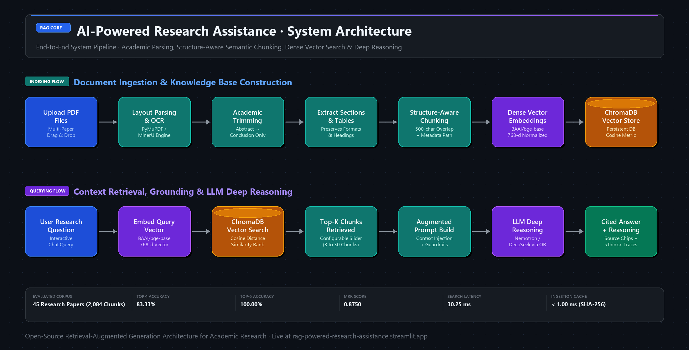

# 🔬 AI-Powered Research Assistance RAG System

[]
[](https://www.python.org/downloads/)
[](https://www.trychroma.com/)
[](https://huggingface.co/BAAI/bge-base-en-v1.5)
[](https://openrouter.ai/)
[](https://opensource.org/licenses/MIT)

A robust, from-scratch **Retrieval-Augmented Generation (RAG)** assistant engineered specifically for academic researchers and students. This application allows users to upload PDF research papers and ask nuanced, high-level or fine-grained questions, receiving synthesized, context-aware answers complete with **direct section citations** and **deep reasoning traces**.

The core RAG pipeline is built **from scratch** (no LangChain, no LlamaIndex) to give full programmatic control over layout parsing, academic boundary trimming, structure-aware semantic chunking, and vector retrieval. A LangChain implementation of the same pipeline (`langchain_rag.py`) lives alongside it — same parsing, chunking, embeddings and index, only the retrieval + answer wiring is LangChain — and the two are benchmarked head-to-head below.

> **No hosted live demo** — run it locally (see Getting Started below).

## 🏆 Benchmark & Retrieval Evaluation

The RAG retrieval engine was systematically evaluated on **35 unique research papers** (37 files — DiskANN and OPQ each appear in two theme folders) comprising **1,611 vector chunks** across 6 themes:
1. **Foundations Papers** (12) — HNSW, NSW, Product Quantization, FAISS, CAGRA, ANN-Benchmarks
2. **GPU Papers** (5) — CAGRA, GGNN, SONG, GPU-accelerated graph search, OPQ
3. **Core Papers** (8) — ScaNN, IVF-RaBitQ, InSituANN, Inverted Multi-Index, Polysemous Codes, VAQ, AQR-HNSW
4. **Auto-Tuning Papers** (3) — Constrained Optimization, HNSW Hyperparameter Tuning, Cluster-Shaped Indices
5. **Resource Constraint** (3) — DiskANN Single-Node, Raspberry Pi & Edge ANN
6. **Server-Grade Benchmarking** (4) — Vector DB evaluation, KScaNN, Unified Vector DB Benchmarks

### Verified Retrieval Performance Metrics

12 thematic questions, strict scoring (a chunk counts as a hit only if its text contains at least 2 of the question's expected keywords **and** its theme matches the question's theme or its section is a specific expected section). Both versions were tested on the **same** Chroma collection — same chunks, same embeddings, same queries, same Top-K — so any difference in the numbers is the wiring, not the data.

| Metric | Original (from scratch) | LangChain version |
| :--- | :---: | :---: |
| **Top-1 Retrieval Accuracy** | **66.67%** (8/12) | **66.67%** (8/12) |
| **Top-3 Retrieval Accuracy** | **100.00%** (12/12) | **100.00%** (12/12) |
| **Top-5 Retrieval Accuracy** | **100.00%** (12/12) | **100.00%** (12/12) |
| **Mean Reciprocal Rank (MRR)** | **0.8194** | **0.8194** |
| **Per-paper coverage** | **100.00%** (12/12) | **100.00%** (12/12) |
| **Average Search Latency (global)** | **~30 ms** | **~29 ms** |
| **Average Search Latency (per-paper set)** | **~256 ms** | **~1,746 ms** |
| **Disk Cache Ingestion Speed** | **< 1.00 ms** | **< 1.00 ms** |

- **Top-1/3/5 and MRR** come from one similarity search across all papers (global ranking). The right paper is first for 8 of 12 questions and in the top 3 for all 12.
- **Per-paper coverage** is what the app actually needs: the fraction of questions where the per-paper set sent to the LLM contains at least one qualifying chunk. It is 12/12 — every question is answerable from the context the app builds.
- The two versions are **identical on every retrieval metric**. LangChain adds nothing to retrieval quality; the original is ~7x faster on the per-paper path.

### LLM Answer Evaluation (Faithfulness)

The same 12 questions were also run end-to-end through each version's full answer path (OpenRouter LLM), and an independent LLM judge — a different model from the one that wrote the answers — scored whether every claim in each answer is supported by the retrieved chunks. The judge was Baidu ERNIE-5.5-Flash-Preview (`baidu/ernie-5.5-flash-preview:free`); it judged all 12 questions for both versions, with no errors.

| Metric | Original (from scratch) | LangChain version |
| :--- | :---: | :---: |
| **Faithfulness (average)** | **99.4%** | **98.8%** |
| **Answers fully faithful (100%)** | **8 of 12** | **9 of 12** |

- **Faithfulness** is the share of claims in the answer that the retrieved context supports. The original version scored 100% on 8 of 12 questions (lowest 97.5% on Q12, quantization survey); the LangChain version scored 100% on 9 of 12 (lowest 88.5% on Q12, where it credited RaBitQ with RSLM's compression numbers). Both versions' answers are essentially fully grounded in the papers — neither version hallucinates materially.
- These numbers replace the earlier run, in which the same model that wrote the answers also judged them (99.5% / 99.8%). The independent judge is slightly stricter, especially on the LangChain version.
- The LLM step is non-deterministic (wording changes every run), so treat faithfulness as a spot-check of answer quality, not a stable benchmark like the retrieval numbers above.

> These figures are from the author's local evaluation on the 35-paper collection above. The evaluation is reproducible from this repo: the scripts are `evaluate_literature_review.py` (full benchmark) and `benchmark_retrieval.py` (retrieval-only, ~40 s on the existing index) — see [Reproduce the benchmark](#reproduce-the-benchmark). The retrieval numbers above are retrieval-only. The faithfulness numbers come from the optional LLM end-to-end step (same script, without `--no-llm`), which runs the 12 questions through each version's full answer path and judges the answers against the retrieved context.

### Reproduce the benchmark

```bash
# Retrieval only, on the existing index (no re-parsing, ~40 s)
python benchmark_retrieval.py

# Full benchmark: parses/indexes only papers not already in the
# collection, then measures retrieval (add --no-llm to skip the LLM step)
python evaluate_literature_review.py --no-llm

# Measure the existing index without touching it
python evaluate_literature_review.py --reuse-index --no-llm

# Full LLM run on the existing index, with an independent judge
# (a different model than the one that wrote the answers)
python evaluate_literature_review.py --reuse-index --judge-model baidu/ernie-5.5-flash-preview:free
```

The benchmark reads the papers from `Literature Review/` (theme subfolders) and `documents/`, and uses the `literature_review_chroma_db` collection inside `upload_pdfs_chroma_db/`. Results are written to `literature_review_benchmark_results.json` (latest run kept in this repo).

---

## 🔀 LangChain Version

`langchain_rag.py` is the same pipeline with LangChain wiring. It reuses the production MinerU parsing, section-aware chunking (~300 words), `bge-base-en-v1.5` embeddings, and the **same** Chroma collection — only retrieval and LLM wiring are LangChain (`langchain-chroma` `Chroma`, `HuggingFaceEmbeddings`, `ChatOpenAI` via OpenRouter, LCEL chain). There is no LangGraph; the chain is a straight line.

The per-paper retrieval behaviour is preserved deliberately (a global Top-K is the bug that used to drop papers): the Top-K budget is split evenly across papers, each paper's Abstract is always included, and the prompt instructs the LLM to cover **every** paper.

```bash
# Ask a question through the LangChain version (needs .env with OPENROUTER_API_KEY)
python langchain_rag.py --ask "what does each paper talk about?" --top-k 15
```

LangChain dependencies are in `requirements.txt` (`langchain>=1.5`, `langchain-chroma>=1.1`, `langchain-huggingface>=1.2`, `langchain-openai>=1.8`). In the benchmark above, its retrieval is identical to the from-scratch version on all 12 questions.

---

## 📐 System Architecture

The pipeline consists of two synchronized, decoupled workflows: **Indexing Flow** (document processing & persistent vector storage) and **Querying Flow** (context retrieval, prompt grounding & LLM reasoning).



---

### Deep Dive: The End-to-End Pipeline

#### 1. Ingestion & Indexing Flow
1. **Upload PDF Files:** Multi-file drag-and-drop ingestion via the Streamlit interface with persistent disk caching.
2. **Layout Parsing (MinerU):** Each PDF is parsed with `MinerUParser` (`basic` tier) into typed blocks — headings, text, equations, tables, figures, code — in reading order, via `doc.structured_content()`. No markdown is involved at this step. If MinerU is unavailable, the fallback is `pymupdf4llm` markdown.
3. **Academic Trimming (inside `extract_paper` in `extract_papers.py`):** Cover pages, headers, footers and front matter are dropped; content is kept from the Abstract/Introduction through the Conclusion, stopping at References, acknowledgments or appendices, so the LLM doesn't hallucinate on citation lists.
4. **Extract Sections & Tables (`extract_paper` in `extract_papers.py`):** `blocks_from_structured()` flattens the `structured_content()` blocks into one list, and `extract_paper()` files each block under its parent section heading — rejoining paragraphs split across columns/pages and assigning each table/figure to the section that discusses it most, instead of the one that merely precedes it.
5. **Structure-Aware Chunking (`chunks_generation`):** Generates overlapping ~300-word chunks with sentence boundary preservation. Each chunk is tagged with its parent section heading, preventing chunks from bleeding across different headers. The size is set in `app.py` (`chunk_size=300`, in words) and is passed through to `chunks_generated.py`.
6. **Dense Vector Embeddings (`create_embedding_text`):** Transforms chunks into normalized 768-dimensional dense vectors using the state-of-the-art `BAAI/bge-base-en-v1.5` model.
7. **ChromaDB Vector Store (`initialize_vector_database`):** Chunks, embeddings, and document IDs are stored persistently in a local ChromaDB collection using cosine similarity scoring.

#### 2. Retrieval & Querying Flow
1. **User Research Question:** The researcher enters a query in the chat interface or selects a suggested research prompt.
2. **Embed Query Vector:** The user's query is normalized and embedded into a 768-d vector using `BAAI/bge-base-en-v1.5`.
3. **ChromaDB Vector Search:** Executes an approximate nearest neighbor (ANN) search against indexed vectors. The search is per-paper: the Top-K budget is split evenly across all indexed papers, instead of one global top-K list that a few papers could fill.
4. **Top-K Chunks Retrieved:** Retrieves the most relevant chunks per paper based on the user-configurable Top-K slider (3 to 30 chunks in total). Each paper's Abstract chunk is also included if the similarity search missed it, so a question like "what does each paper talk about?" gets chunks from every paper, not just the most similar ones.
5. **Augmented Prompt Construction (`query_builder`):** Formulates a grounded context window pairing retrieved chunks with document titles, section headers, and strict grounding instructions. The context is grouped by paper, and the LLM is instructed to cover every paper, one section per paper, and not skip any.
6. **LLM Deep Reasoning (`answer_generator`):** Dispatches the prompt to OpenRouter API (default model `nvidia/nemotron-3.5-super-vl:free`, overridable with the `RAG_LLM_MODEL` env var), capturing `<think>...</think>` internal reasoning traces.
7. **Cited Synthesis & Reasoning Output:** Renders the synthesized response in the dark-themed UI, surfaces clickable source chips (Paper Title + Section Heading), and exposes the reasoning steps in an expandable drawer.

---

## ✨ Key Features

- **Deep Reasoning Traces:** Full inspection of internal model reasoning steps (`<think>...</think>`) in a collapsible drawer.
- **Granular Source Citations:** Every response surfaces interactive chips showing the exact document title, section heading, and whether the evidence originated from a table.
- **Configurable Top-K Slider:** Adjust context breadth from 3 to 30 chunks directly from the sidebar. The budget is split evenly across papers, so every indexed paper is represented in the answer.
- **Structure-Aware Semantic Chunking:** Chunks respect paragraph and section boundaries, preventing semantic fragmentation.
- **Instant Ingestion with Caching:** SHA-256 disk cache prevents redundant parsing on repeated files (<1ms reload).
- **Executive Dark UI:** Custom glassmorphism CSS theme built with Inter typography, animated response bubbles, and clean status indicators.
- **LangChain Version Included:** `langchain_rag.py` offers the same pipeline with LangChain retrieval + answer wiring, benchmarked head-to-head against the from-scratch version (identical retrieval, see above).
- **Benchmarked Retrieval:** The retrieval engine is evaluated on 35 papers / 12 questions with strict scoring; the scripts and latest results are in the repo.

---

## 🛠️ Tech Stack

| Component | Technology | Role |
| :--- | :--- | :--- |
| **Frontend UI** | [Streamlit](https://streamlit.io/) | Reactive web application with custom CSS styling |
| **Document Parsing** | `MinerU` | Layout-aware structural markdown & table extraction | 
| **Embedding Model** | `BAAI/bge-base-en-v1.5` | 768-dimensional normalized dense semantic representations |
| **Vector Database** | [ChromaDB](https://www.trychroma.com/) | Persistent local vector client with cosine distance indexing |
| **LLM Backend** | OpenRouter API | Reasoning model (`nvidia/nemotron-3.5-super-vl:free` by default; set `RAG_LLM_MODEL` to change it) |
| **LangChain Version** | `langchain`, `langchain-chroma`, `langchain-huggingface`, `langchain-openai` | Alternative retrieval + answer wiring over the same parsing, chunking, embeddings and index |
| **Environment** | Python 3.10+ | Core execution runtime |

---

## 🚀 Getting Started

### 1. Prerequisites
Ensure you have **Python 3.10** or higher installed.

### 2. Clone & Install
```bash
# Clone the repository
git clone https://github.com/Tatsat-Pathak/Research-Assistance-RAG-System.git
cd Research-Assistance-RAG-System

# Install dependencies
pip install -r requirements.txt
```

### 3. Configure API Key
Create a `.env` file in the root directory:
```env
OPENROUTER_API_KEY=your_openrouter_api_key_here
```
Or set `OPENROUTER_API_KEY` in your host's secrets / environment variables if you deploy it yourself. There is deliberately no key input in the app UI — the key must never be typed into, or displayed by, the interface. Without a key, uploading and indexing still work, but asking questions will show a clear "no API key set" error instead of a cryptic API failure.

### 4. Run Locally
```bash
streamlit run app.py
```
Open your browser at `http://localhost:8501`, drop your PDF papers into the sidebar, click **⚡ Index Documents**, and ask your research questions!

### 5. Try the LangChain Version
```bash
python langchain_rag.py --ask "what does each paper talk about?" --top-k 15
```
Needs `.env` with `OPENROUTER_API_KEY`. It answers from the same Chroma collection the app builds.

### 6. Run the Benchmark
```bash
python benchmark_retrieval.py          # retrieval only, ~40 s on the existing index
python evaluate_literature_review.py --no-llm   # full benchmark (incremental index + retrieval)
```
See [Reproduce the benchmark](#reproduce-the-benchmark).

---

## 📂 Repository Structure

```
Research-Assistance-RAG-System/
├── app.py                              # Streamlit frontend with custom dark theme & reasoning UI
├── RAG_Pipeline.py                     # Core RAG logic: parsing, chunking, embedding & OpenRouter LLM
├── extract_papers.py                   # Section/table/equation extraction from MinerU structured output
├── chunks_generated.py                 # Structure-aware chunking (~300-word chunks, section paths)
├── langchain_rag.py                    # LangChain version: same parsing/chunking/index, LangChain retrieval + answer wiring
├── evaluate_literature_review.py       # Full benchmark: incremental index + retrieval + optional LLM end-to-end
├── benchmark_retrieval.py              # Retrieval-only benchmark (global ranking + per-paper coverage) + scoring & queries
├── test_evaluate_benchmark.py          # Tests for the benchmark (fake embeddings/LLM, no model or key needed)
├── literature_review_benchmark_results.json  # Latest benchmark results
├── rag_architecture.png                # High-resolution system architecture diagram
├── requirements.txt                    # Pinned/bounded production dependencies
├── LICENSE                             # MIT License
├── .gitignore                          # Excludes caches, vector databases, and private PDFs
└── README.md                           # Project documentation & benchmark evaluation results
```

### Hosting notes
- PDFs are parsed **sequentially by default** (one document at a time). Each parallel MinerU worker loads its own copy of the parser models, so parallel parsing can use several times the RAM and crash a small host. Set `RAG_MAX_WORKERS=2` only on a host with RAM to spare.
- Uploaded PDFs, the parse cache, and the ChromaDB index live in local folders (`uploaded_pdfs/`, `parse_cache/`, `upload_pdfs_chroma_db/`) and are **not persistent** on hosted platforms that wipe disk on restart/sleep — after a cold start, papers must be uploaded and indexed again.

---

## 📄 License
Distributed under the **MIT License**. See `LICENSE` for more information.
